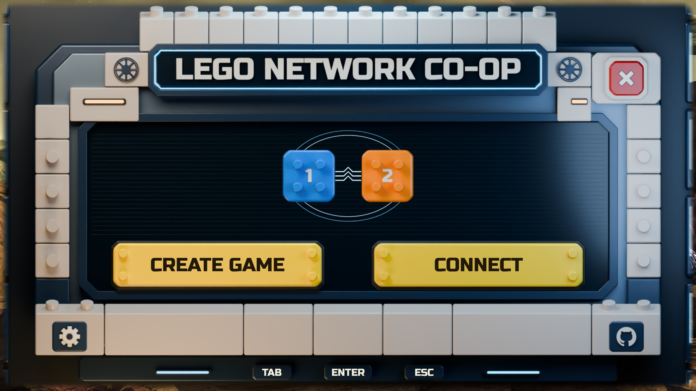

# LEGO Star Wars III: The Clone Wars

[Русский](README.ru.md)

Network co-op for two Windows PCs. One player hosts, the other joins by IP, and each player has their own camera and the original HUD.

**Beta 1 — 0.1.0.** A new LEGO-style co-op menu with room creation, IP connection, camera selection and button sounds. Start missions from the Resolute map and return to the ship in the same co-op session.

Desyncs can still occur. We're working on fixes for the next update.

- [Download 0.1.0 Beta 1](https://github.com/dakkaboy/lego-network-coop/releases/tag/v0.1.0)
- [Nexus Mods](https://www.nexusmods.com/legostarwars3theclonewars/mods/28)



## Build

Install Zig 0.17.1. With Zig on `PATH`, run this in the game project directory.

```powershell
./build-camera.ps1
```

The x86 build writes `d3d9.dll` and `clonewars-camera.dll` to `build/`. The proxy loads the mod, which owns the camera, game hooks and network session. Both players need the same build.

## Run

Close the game and copy both DLLs next to `LEGOCloneWars.exe`. Back up any existing `d3d9.dll` before replacing it. Open F12, select Create game on one PC, then enter the host IP and select Connect on the other. Close the menu and start a mission on the host. The mod uses TCP port 32510.

## Source layout

- `src/zig/` contains the mod's Zig code: networking, synchronization, cameras, UI and diagnostics.
- `build.zig` builds the 32-bit DLLs and tools.
- `src/engine/proxy.def` lists the proxy DLL's exported functions.

The mod targets the Windows edition of the game. Build both DLLs with `zig build dll`. Enable profiling with `-Dtracy=true`.
