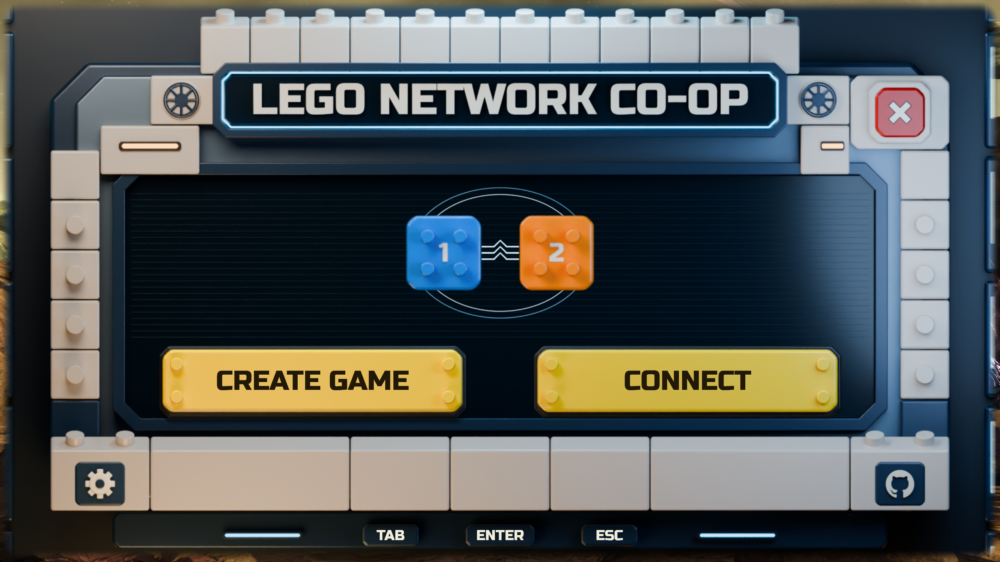

# LEGO Star Wars III: The Clone Wars

[English](README.md)

Сетевой кооператив для двух ПК с Windows. Один игрок запускает хост, второй подключается по IP. У каждого игрока своя камера и штатный HUD.

**Beta 1 — 0.1.0.** Новое меню кооператива в стиле LEGO: создание комнаты, подключение по IP, выбор камеры и звук кнопок. Миссии можно запускать с карты «Резолют» и возвращаться на корабль в том же сеансе.

Иногда возможен рассинхрон. Исправления готовим к следующему обновлению.

- [Скачать 0.1.0 Beta 1](https://github.com/dakkaboy/lego-network-coop/releases/tag/v0.1.0)
- [Nexus Mods](https://www.nexusmods.com/legostarwars3theclonewars/mods/28)



## Сборка

Установите Zig 0.17.1. Добавьте Zig в `PATH` и выполните команду из папки игры в репозитории.

```powershell
./build-camera.ps1
```

Сборка x86 сохраняет `d3d9.dll` и `clonewars-camera.dll` в папку `build/`. DLL-прокси загружает мод, который управляет камерой, перехватчиками и сетевой сессией. Обоим игрокам нужна одинаковая сборка.

## Запуск

1. Закройте игру. Если в её папке уже есть `d3d9.dll`, сохраните копию.
2. Скопируйте обе DLL в папку с `LEGOCloneWars.exe`.
3. Откройте меню `F12` на обоих ПК. Первый игрок выбирает **Create game**, второй вводит IP хоста и выбирает **Connect**.
4. Закройте меню. Хост запускает миссию. Мод использует TCP-порт 32510.

## Исходный код

- `src/zig/` — код мода на Zig: сеть, синхронизация, камеры, интерфейс и диагностика.
- `build.zig` — сборка 32-битных DLL и инструментов.
- `src/engine/proxy.def` — экспортируемые функции DLL-прокси.

Мод рассчитан на Windows-версию игры. Обе DLL собираются командой `zig build dll`. Для профилирования доступен параметр `-Dtracy=true`.
